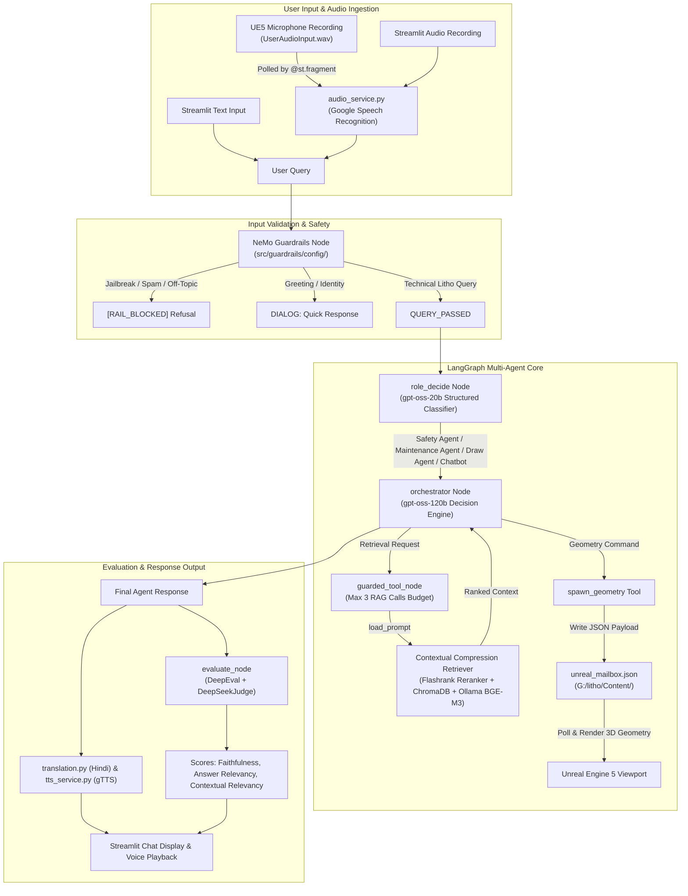

# Litho Agentic RAG

### Guarded Multi-Agent RAG & Unreal Engine 5 Simulation System for Semiconductor Cleanroom Operations

Project **Litho Agentic RAG** is an active, multi-agent AI system developed for **NIT Rourkela** to assist engineers, researchers, and students in semiconductor photolithography and cleanroom operations.

The system connects a **Streamlit / LangGraph AI Brain** with **Unreal Engine 5 (UE5)**, providing voice- and text-driven technical document retrieval, cleanroom hazard and safety enforcement, hardware maintenance diagnostics, and real-time CAD geometry dispatching into 3D simulation.

---

## Architecture Overview



---

## Core System Modules

### 1. Multi-Agent Orchestration (`src/core/graph.py`)
- **Guardrails Node (`guardrail_node`):** Runs incoming queries through NeMo Guardrails. To avoid multi-threaded event-loop deadlocks during Streamlit reruns, the rail instance is created per-call and bound to the active thread's loop.
- **Intent Classifier (`role_decide`):** Employs `openai/gpt-oss-20b` with structured output schemas to categorize requests into:
  - **Safety Agent:** Cleanroom compliance (Class 100/1000), chemical hazards, emergency procedures.
  - **Maintenance Agent:** Hardware wear, stepper calibration, laser alignment, vacuum systems.
  - **Draw Agent:** Geometric construction, wafer layout, pattern generation in 3D.
  - **Chatbot:** Orientation and general operational inquiries.
- **Orchestration Engine (`orchestrator_node`):** Powered by `openai/gpt-oss-120b` for multi-step reasoning, tool delegation, and final synthesis.
- **Retrieval Rate Limiter (`guarded_tool_node`):** Caps document retrieval calls at **3 calls per question** to prevent tool loops.
- **Evaluation Judge (`evaluate_node`):** Automatically evaluates every response via DeepEval using a custom `DeepSeekJudge` class (`deepseek/deepseek-chat` via LiteLLM) scoring:
  - **Faithfulness:** Groundedness against retrieved cleanroom documentation.
  - **Answer Relevancy:** Query-to-answer alignment.
  - **Contextual Relevancy:** Signal-to-noise ratio in retrieved context.

### 2. Two-Stage Neural Re-Ranked RAG (`src/core/retriever.py`)
- **Stage 1 (Dense Retrieval):** ChromaDB vector store loaded with local Ollama `bge-m3:latest` embeddings retrieves the top 25 candidate chunks.
- **Stage 2 (Cross-Encoder Re-Ranking):** `FlashrankRerank` (`ms-marco-TinyBERT-L-2-v2`) re-scores and narrows candidates down to the top 7 high-precision snippets.
- **Prompt Packaging (`load_prompt`):** Formats retrieved text into strict 300-word constraint prompts tailored for cleanroom accuracy.

### 3. Spatial Geometry Dispatcher (`src/core/tools.py`)
- **`spawn_geometry` Tool:** Deconstructs user drawing commands into chronological coordinate lists (`line`, `polygon`, `circle`) with absolute angle references ($0^\circ$ = Horizontal, $90^\circ$ = Vertical).
- **Serverless File Bridge:** Writes timestamped JSON packets to `G:/litho/Content/unreal_mailbox.json`. Unreal Engine 5 reads this file and renders the corresponding 3D spline and mesh actors in real-time.

### 4. Audio, Translation & Localization (`src/services/`)
- **Unreal Audio Listener (`audio_service.py`):** Uses `@st.fragment(run_every=2)` to continuously poll `G:\litho\Saved\UserAudioInput.wav.wav`. Handles file locks, stages audio to a processing buffer, and transcribes using Google Speech Recognition.
- **Native Browser Audio:** Direct microphone input supported via Streamlit's chat bar.
- **Hindi Translation (`translation.py`):** Localized translation using `deep-translator`.
- **Text-to-Speech (`tts_service.py`):** In-memory `gTTS` audio stream generator with automatic Devanagari Unicode detection (`hi` vs `en`).

### 5. Document Ingestion Pipeline (`our_database/`)
- **`document_docling.py`:** Utilizes IBM Docling (`DocumentConverter`) to batch parse multi-column technical PDFs and cleanroom manuals into clean Markdown.
- **`load_txt.py`:** Sanitizes non-printable control characters, chunks text via `RecursiveCharacterTextSplitter` (1000 characters, 150 overlap), and builds the local ChromaDB index.

---

## Directory Structure

```
RAG-Lithography/
├── our_database/                     # Data Ingestion & Storage
│   ├── database_documents/           # Source PDF manuals & SOPs
│   ├── chroma_storage/               # Local ChromaDB persistent vector database
│   ├── all_contents.txt              # Extracted Markdown knowledge base
│   ├── document_docling.py           # Docling PDF-to-Markdown batch converter
│   └── load_txt.py                   # Document chunker & vector database builder
│
├── src/                              # Application Source Code
│   ├── core/                         # Core Agents & Tools
│   │   ├── graph.py                  # LangGraph state machine & DeepEval judge
│   │   ├── retriever.py              # Flashrank re-ranked RAG retriever
│   │   └── tools.py                  # spawn_geometry CAD tool & mailbox writer
│   │
│   ├── guardrails/                   # Guardrail Definitions
│   │   └── config/
│   │       ├── config.yml            # NeMo Guardrails configuration
│   │       ├── prompts.yml           # Rail prompts
│   │       └── rails.co              # Colang dialogue flows & domain rules
│   │
│   ├── services/                     # Supporting Services
│   │   ├── audio_service.py          # Unreal Engine audio watcher & transcriber
│   │   ├── translation.py            # Deep-translator Hindi translation
│   │   └── tts_service.py            # gTTS text-to-speech engine
│   │
│   └── ui/                           # User Interface
│       └── app.py                    # Streamlit interface
│
├── .env                              # Environment configuration
├── pyproject.toml                    # Project package metadata
├── requirements.txt                  # Python dependencies
└── README.md                         # Documentation
```

---

## Tech Stack & Models

| Layer | Component | Specification |
| :--- | :--- | :--- |
| **Agent Framework** | LangChain, LangGraph | State machine routing, tool loops, conditional branching |
| **Reasoning LLM** | Groq `openai/gpt-oss-120b` | Orchestration, synthesis, geometry command generation |
| **Routing LLM** | Groq `openai/gpt-oss-20b` | Structured Pydantic intent classification |
| **Safety Guardrails** | NeMo Guardrails | Colang dialogue policies and domain constraints |
| **Embeddings** | Ollama `bge-m3:latest` | Local 1024-dim dense multilingual vector embeddings |
| **Re-Ranker** | Flashrank `ms-marco-TinyBERT-L-2-v2` | Low-latency cross-encoder contextual compression |
| **Vector Store** | ChromaDB | Persistent vector storage with cosine distance metric |
| **Document Parser** | IBM Docling | Multi-column PDF and table extraction |
| **Evaluation** | DeepEval + DeepSeek API | Online Faithfulness, Relevancy, and Context scoring |
| **Simulation** | Unreal Engine 5.7 | 3D Lithography simulation & coordinate rendering |
| **Speech Pipeline** | Google Speech Recognition, `gTTS` | Dual-mode STT & script-aware TTS synthesis |
| **UI** | Streamlit | Real-time chat, telemetry, and evaluation metrics UI |

---

## Setup & Installation

### 1. Prerequisites
- **Python 3.10 to 3.12**
- **Ollama** installed and running locally. Pull the embedding model:
  ```bash
  ollama pull bge-m3:latest
  ```

### 2. Install Dependencies
```bash
git clone (https://github.com/101ayushraj/Litho_Agentic_RAG.git)
cd RAG-Lithography

python -m venv .venv
.venv\Scripts\activate   # Windows
# source .venv/bin/activate # Linux/macOS

pip install -r requirements.txt
```

### 3. Configure Environment (`.env`)
Create a `.env` file in the root directory:
```ini
GROQ_API_KEY=gsk_your_groq_api_key
DEEPSEEK_API_KEY=sk_your_deepseek_api_key

# Optional: LangSmith Monitoring
LANGCHAIN_TRACING_V2=true
LANGCHAIN_API_KEY=lsv2_pt_your_langsmith_api_key
LANGCHAIN_PROJECT=Project-Litho-Agentic-RAG
```

---

## Running the Project

### Step 1: Ingest Documents & Build Vector Store
Place PDF documents inside `our_database/database_documents/` and run:
```bash
python our_database/document_docling.py
python our_database/load_txt.py
```

### Step 2: Start the Streamlit Application
Run the Streamlit application from the project root:
```bash
streamlit run src/ui/app.py
```

### Step 3: Configure Unreal Engine 5
1. Open the **Unreal Engine 5.7** Lithography project.
2. In `BP_MicManager`, ensure audio recordings are saved to: `Your_Project\Saved\UserAudioInput.wav.wav`.
3. Configure your rendering blueprint to poll `Your_Project\Content\unreal_mailbox.json` on tick and render the incoming geometry commands.
4. If paths differ from `G:/litho/...`, update `UNREAL_AUDIO_PATH` in `src/services/audio_service.py` and `mailbox_dir` in `src/core/tools.py`.

---

## Guardrails & Evaluation Reference

### Guardrail Status Codes

| Trigger | Status | Description |
| :--- | :--- | :--- |
| Cleanroom SOPs, Equipment, Hazards | `QUERY_PASSED` | Routed into LangGraph agent pipeline |
| Greetings, Identity ("Who are you?") | `DIALOG:` | Direct conversational reply without retrieval overhead |
| Off-Topic, Jokes, Jailbreaks, Spam | `[RAIL_BLOCKED]` | Intercepted with safe domain refusal message |

### DeepEval Quality Metrics

| Metric | Threshold | Purpose |
| :--- | :---: | :--- |
| **Faithfulness** | $\ge 0.50$ | Verifies output is strictly grounded in retrieved documentation |
| **Answer Relevancy** | $\ge 0.50$ | Evaluates answer completeness relative to user intent |
| **Contextual Relevancy** | $\ge 0.50$ | Assesses precision and relevance of retrieved text chunks |
#
