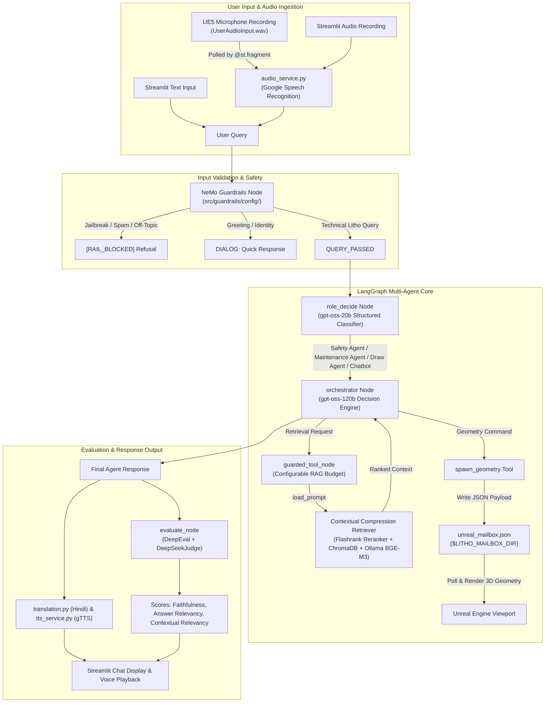

# Litho Agentic RAG

### Guarded Multi-Agent RAG & Unreal Engine Simulation System for Semiconductor Cleanroom Operations

Project **Litho Agentic RAG** is an active, multi-agent AI system developed for **NIT Rourkela** to assist engineers, researchers, and students in semiconductor photolithography and cleanroom operations.

The system connects a **Streamlit / LangGraph AI Brain** with **Unreal Engine (UE)**, providing voice- and text-driven technical document retrieval, cleanroom hazard and safety enforcement, hardware maintenance diagnostics, and real-time CAD geometry dispatching into 3D simulation.

> **Project handbook (PDF):** [docs/Litho_Agentic_RAG_Project_Guide.pdf](docs/Litho_Agentic_RAG_Project_Guide.pdf)
> covers the purpose, architecture, workflow, evaluation design, deployment and 108 interview
> questions with detailed answers. Its source is in [docs/guide/](docs/guide/).

---

## Architecture Overview



---

## Core System Modules

### 1. Multi-Agent Orchestration (`src/core/graph.py`)
- **Guardrails Node (`guardrail_node`):** Runs incoming queries through NeMo Guardrails. To avoid multi-threaded event-loop deadlocks during Streamlit reruns, the rail instance is created per-call and bound to the active thread's loop.
- **Intent Classifier (`role_decide`):** Employs `openai/gpt-oss-20b` with structured output schemas to categorize requests into:
  - **Safety Agent:** Cleanroom compliance (configured cleanroom classes), chemical hazards, emergency procedures.
  - **Maintenance Agent:** Hardware wear, stepper calibration, laser alignment, vacuum systems.
  - **Draw Agent:** Geometric construction, wafer layout, pattern generation in 3D.
  - **Chatbot:** Orientation and general operational inquiries.
- **Orchestration Engine (`orchestrator_node`):** Powered by `openai/gpt-oss-120b` for multi-step reasoning, tool delegation, and final synthesis.
- **Retrieval Rate Limiter (`guarded_tool_node`):** Caps document retrieval calls using the configured budget to prevent tool loops.
- **Evaluation Judge (`evaluate_node`):** Scores each response with DeepEval using a custom `DeepSeekJudge` class (`deepseek/deepseek-chat` via LiteLLM). Requires `DEEPSEEK_API_KEY`; a missing key or a failed API call is recorded as an error instead of a score. The three metrics are:
  - **Faithfulness:** Groundedness against retrieved cleanroom documentation.
  - **Answer Relevancy:** Query-to-answer alignment.
  - **Contextual Relevancy:** Signal-to-noise ratio in retrieved context.

### 2. Two-Stage Neural Re-Ranked RAG (`src/core/retriever.py`)
- **Stage 1 (Dense Retrieval):** ChromaDB vector store loaded with local Ollama `bge-m3:latest` embeddings retrieves the configured candidate chunks.
- **Stage 2 (Cross-Encoder Re-Ranking):** `FlashrankRerank` (`ms-marco-TinyBERT-L-2-v2`) re-scores and narrows candidates to the configured final snippets.
- **Prompt Packaging (`load_prompt`):** Formats retrieved text into length-constrained prompts tailored for cleanroom accuracy.

### 3. Spatial Geometry Dispatcher (`src/core/tools.py`)
- **`spawn_geometry` Tool:** Deconstructs user drawing commands into chronological coordinate lists (`line`, `polygon`, `circle`) with absolute angle references ($0^\circ$ = Horizontal, $90^\circ$ = Vertical).
- **Serverless File Bridge:** Writes timestamped JSON packets to `$LITHO_MAILBOX_DIR/unreal_mailbox.json` (default `./runtime/unreal_mailbox/unreal_mailbox.json`). Unreal Engine 5 reads this file and renders the corresponding 3D spline and mesh actors in real-time.

### 4. Audio, Translation & Localization (`src/services/`)
- **Unreal Audio Listener (`audio_service.py`):** Uses periodic Streamlit polling to continuously watch `$LITHO_AUDIO_PATH` (default `./runtime/UserAudioInput.wav`). Handles file locks, stages audio to a processing buffer, and transcribes using Google Speech Recognition.
- **Native Browser Audio:** Direct microphone input supported via Streamlit's chat bar.
- **Hindi Translation (`translation.py`):** Localized translation using `deep-translator`.
- **Text-to-Speech (`tts_service.py`):** In-memory `gTTS` audio stream generator with automatic Devanagari Unicode detection (`hi` vs `en`).

### 5. Document Ingestion Pipeline (`our_database/`)
- **`document_docling.py`:** Utilizes IBM Docling (`DocumentConverter`) to batch parse multi-column technical PDFs and cleanroom manuals into clean Markdown.
- **`load_txt.py`:** Sanitizes non-printable control characters, chunks text with the configured splitter, and builds the local ChromaDB index.

---

## Directory Structure

```
Agentic-RAG/
├── our_database/                     # Data Ingestion & Storage
│   ├── database_documents/           # Source PDF manuals & SOPs
│   ├── chroma_storage/               # Local ChromaDB persistent vector database
│   ├── all_contents.txt              # Extracted Markdown knowledge base
│   ├── document_docling.py           # Docling PDF-to-Markdown batch converter
│   └── load_txt.py                   # Document chunker & vector database builder
│
├── src/                              # Application Source Code
│   ├── core/                         # Core Agents & Tools
│   │   ├── graph.py                  # LangGraph state machine & DeepEval judge
│   │   ├── geometry.py               # Validation, packet writer, replay
│   │   ├── retriever.py              # Flashrank re-ranked RAG retriever
│   │   └── tools.py                  # spawn_geometry CAD tool & mailbox writer
│   │
│   ├── guardrails/                   # Guardrail Definitions
│   │   └── config/
│   │       ├── config.yml            # NeMo Guardrails configuration
│   │       ├── prompts.yml           # Rail prompts
│   │       └── rails.co              # Colang dialogue flows & domain rules
│   │
│   ├── services/                     # Supporting Services
│   │   ├── audio_service.py          # Unreal Engine audio watcher & transcriber
│   │   ├── translation.py            # Deep-translator Hindi translation
│   │   ├── tts_service.py            # gTTS text-to-speech engine
│   │   └── ue_ack.py                 # Waits for Unreal's render acknowledgement
│   │
│   └── ui/                           # Streamlit frontend
│       ├── app.py                    # Navigation only
│       ├── state.py                  # Mode, session, rate limits
│       ├── data.py                   # Cached result/dataset loaders
│       ├── components/               # Chat, charts, citations, trace, geometry
│       └── pages/                    # Assistant, Benchmark, Playground, Labs
│
├── Dockerfile                        # Streamlit container
├── .streamlit/                       # Theme + secrets template
├── runtime/                          # Local Unreal exchange files (gitignored)
│   ├── unreal_mailbox/               # Default LITHO_MAILBOX_DIR
│   └── UserAudioInput.wav            # Default LITHO_AUDIO_PATH
│
├── docs/
│   ├── CLAIMS_TO_VERIFY.md           # Claims awaiting a committed benchmark
│   ├── CORPUS_SOURCES.md             # Source documents and licence status
│   ├── LIMITATIONS.md                # Known limitations
│   ├── REPRODUCE.md                  # Commands, hardware, cost formula
│   ├── STATUS.md                     # Open blockers
│   └── UNREAL_ACK.md                 # Blueprint ack contract
│
├── scripts/
│   ├── run_all_arms.sh               # Dev/test arm sweep
│   ├── measure_e2e.py                # Fake/real Unreal latency
│   ├── build_readme.py               # Render results blocks
│   ├── claim_check.py                # Numeric-claim guard
│   ├── regression_gate.py            # Headline metric gate
│   ├── export_judge_sample.py        # Judge-labelling CSV
│   └── judge_agreement.py            # Agreement + kappa
│
├── results/                          # Generated; empty of real numbers
├── tools/
│   └── fake_unreal.py                # Ack writer for tests/CI
├── tests/                            # Offline pytest suite
├── .github/workflows/ci.yml          # Lint + tests in CI
├── .env.example                      # Documented environment variables
├── Makefile                          # test / lint / format
├── pyproject.toml                    # Project metadata, ruff and pytest config
├── requirements.txt                  # Pinned direct dependencies
└── README.md                         # Documentation
```

---

## Tech Stack & Models

| Layer | Component | Specification |
| :--- | :--- | :--- |
| **Agent Framework** | LangChain, LangGraph | State machine routing, tool loops, conditional branching |
| **Reasoning LLM** | Groq `openai/gpt-oss-120b` | Orchestration, synthesis, geometry command generation |
| **Routing LLM** | Groq `openai/gpt-oss-20b` | Structured Pydantic intent classification |
| **Safety Guardrails** | NeMo Guardrails | Colang dialogue policies and domain constraints |
| **Embeddings** | Ollama `bge-m3:latest` | Local dense multilingual vector embeddings |
| **Re-Ranker** | Flashrank `ms-marco-TinyBERT-L-2-v2` | Low-latency cross-encoder contextual compression |
| **Vector Store** | ChromaDB | Persistent vector storage with cosine distance metric |
| **Document Parser** | IBM Docling | Multi-column PDF and table extraction |
| **Evaluation** | DeepEval + DeepSeek API | Online Faithfulness, Relevancy, and Context scoring |
| **Simulation** | Unreal Engine | 3D Lithography simulation & coordinate rendering |
| **Speech Pipeline** | Google Speech Recognition, `gTTS` | Dual-mode STT & script-aware TTS synthesis |
| **UI** | Streamlit | Real-time chat, telemetry, and evaluation metrics UI |

---

## Authorship

Ownership is not recorded in the repository. Fill in the "Built by" column;
nothing has been inferred from commit history.

| Component | Built by | Notes |
| :--- | :--- | :--- |
| Guardrails (NeMo rails, `src/guardrails/config/`) | TODO | Input validation, refusal policy, dialogue flows |
| Retrieval (`src/core/retriever.py`) | TODO | ChromaDB + Ollama embeddings + FlashRank re-ranking |
| Agent graph (`src/core/graph.py`) | TODO | LangGraph nodes, routing, orchestration, evaluation |
| Geometry bridge (`src/core/tools.py`) | TODO | Writes `unreal_mailbox.json` for Unreal to poll |
| Unreal Blueprint (audio capture, geometry rendering) | TODO | Lives in the Unreal project, not in this repo |
| Streamlit UI (`src/ui/app.py`) | TODO | Chat, audio polling, translation, TTS |
| Ingestion (`our_database/document_docling.py`, `load_txt.py`) | TODO | PDF → Markdown → chunks → ChromaDB |

---

## Setup & Installation

### 1. Prerequisites
- **The Python version declared in `pyproject.toml`** (matches `requires-python` and CI)
- **Ollama** installed and running locally. Pull the embedding model:
  ```bash
  ollama pull bge-m3:latest
  ```

### 2. Install Dependencies
```bash
git clone https://github.com/amankumar5345/Agentic-RAG.git
cd Agentic-RAG

python -m venv .venv
.venv\Scripts\activate   # Windows
# source .venv/bin/activate # Linux/macOS

pip install -r requirements.txt
```

### 3. Configure Environment (`.env`)
Copy the template and fill in the keys:
```bash
cp .env.example .env
```
```ini
GROQ_API_KEY=...
DEEPSEEK_API_KEY=...

# Paths for the Unreal bridge (defaults shown)
LITHO_MAILBOX_DIR=./runtime/unreal_mailbox
LITHO_AUDIO_PATH=./runtime/UserAudioInput.wav

# Optional: LangSmith Monitoring
LANGCHAIN_TRACING_V2=true
LANGCHAIN_API_KEY=...
LANGCHAIN_PROJECT=Project-Litho-Agentic-RAG
```
`.env` is gitignored. `LITHO_MAX_SIZE` is enforced by `src/core/geometry.py`;
`LITHO_ACK_TIMEOUT_S` is a suggested timeout for `wait_for_ack`; `LITHO_MODE`
forces `demo` or `live` and is otherwise inferred from the API keys.

### 4. Run Checks
```bash
make test
make lint
```
Both run offline; the test bootstrap supplies dummy API keys.

---

## Running the Project

### Step 1: Ingest Documents & Build Vector Store
Place PDF documents inside `our_database/database_documents/` and run:
```bash
python our_database/document_docling.py
python our_database/load_txt.py
```

### Step 2: Start the Streamlit Application
Run from the project root. Without keys the app starts in **demo** mode and
replays recorded results; with keys set it starts in **live** mode. The banner
always shows the active mode.
```bash
streamlit run src/ui/app.py
```

```bash
# force a mode
LITHO_MODE=demo streamlit run src/ui/app.py
LITHO_MODE=live streamlit run src/ui/app.py
```

Docker:
```bash
docker build -t litho-rag .
docker run -p 8501:8501 litho-rag
```

Streamlit Community Cloud: set the main file to `src/ui/app.py`, install from
`requirements.txt`, and copy `.streamlit/secrets.toml.example` into the app
secrets. Demo mode needs no secrets.

### Screenshots
Run the app in demo mode, open each page, and capture the wide layout. Save
files under `docs/screenshots/` (create the directory; screenshots are not
committed by default):

```text
docs/screenshots/benchmark.png
docs/screenshots/dataset.png
docs/screenshots/geometry.png
docs/screenshots/safety.png
docs/screenshots/playground.png
docs/screenshots/assistant.png
docs/screenshots/methodology.png
```

A 60-second click-through is in [docs/DEMO.md](docs/DEMO.md).

### Step 3: Configure Unreal Engine
1. Open the **Unreal project** for Lithography.
2. In `BP_MicManager`, save recordings to the path set in `LITHO_AUDIO_PATH` (default `./runtime/UserAudioInput.wav`, resolved from the app's working directory). If your Blueprint writes `UserAudioInput.wav.wav`, point the variable at that name.
3. Configure the rendering blueprint to poll `LITHO_MAILBOX_DIR/unreal_mailbox.json` (default `./runtime/unreal_mailbox/unreal_mailbox.json`) on tick and render the incoming geometry commands.
4. No drive letters are hard-coded; set the two environment variables if Unreal writes elsewhere.
5. To close the render loop, make Unreal write `unreal_ack.json` after rendering; see [docs/UNREAL_ACK.md](docs/UNREAL_ACK.md).

---

## Guardrails & Evaluation Reference

### Guardrail Status Codes

| Trigger | Status | Description |
| :--- | :--- | :--- |
| Cleanroom SOPs, Equipment, Hazards | `QUERY_PASSED` | Routed into LangGraph agent pipeline |
| Greetings, Identity ("Who are you?") | `DIALOG:` | Direct conversational reply without retrieval overhead |
| Off-Topic, Jokes, Jailbreaks, Spam | `[RAIL_BLOCKED]` | Intercepted with safe domain refusal message |

## Status

Online DeepEval telemetry exists (live telemetry, not a benchmark):
`evaluate_node` scores each answer at runtime with Faithfulness, Answer
Relevancy and Contextual Relevancy using the DeepSeek judge, and the Streamlit
UI shows the per-answer scores. Tool correctness is only scored when a gold
list of expected tools is supplied in the graph state. This needs
`DEEPSEEK_API_KEY` and network access; failures are stored as errors.

A reproducible, seeded benchmark is in progress. No aggregate scores are
published in this README, and no number here should be read as a benchmark
result until it comes from a committed file under `results/`.

Earlier score and threshold claims were moved to
[docs/CLAIMS_TO_VERIFY.md](docs/CLAIMS_TO_VERIFY.md).

## Results

### Arm comparison

<!-- RESULTS:arms -->
_NOT YET RUN._
<!-- /RESULTS:arms -->

### Guardrails

<!-- RESULTS:guardrails -->
_NOT YET RUN._
<!-- /RESULTS:guardrails -->

### Geometry bridge

<!-- RESULTS:geometry -->
_NOT YET RUN._
<!-- /RESULTS:geometry -->

### End-to-end latency

<!-- RESULTS:e2e_latency -->
_NOT YET RUN._
<!-- /RESULTS:e2e_latency -->

### Indirect injection

<!-- RESULTS:injection -->
_NOT YET RUN._
<!-- /RESULTS:injection -->

### Citations

<!-- RESULTS:citations -->
_NOT YET RUN._
<!-- /RESULTS:citations -->

### Judge validation

<!-- RESULTS:judge_validation -->
_NOT YET RUN._
<!-- /RESULTS:judge_validation -->

### Limitations

<!-- RESULTS:limitations -->
- LLM-drafted questions share vocabulary with their source passages, which
  flatters lexical and dense retrieval.
- The corpus is one collection of documents, dominated by laser-safety
  material and vendor manuals; results do not generalise to other cleanrooms.
- One generator model family is evaluated. Other models may follow injected
  instructions differently.
- Sample sizes are small; confidence intervals will be wide.
- The judge is itself a language model and can be biased toward its own
  outputs or toward fluent answers.
- End-to-end latency has two modes: fake Unreal acknowledgements and real
  Unreal Engine runs. Fake numbers are only for CI and are never real
  measurements.
- There is no user study; usability and trust are not measured.
<!-- /RESULTS:limitations -->
